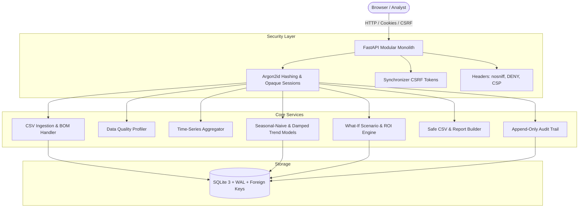

# Lake Toba Tourism Intelligence

[](https://github.com/samuelhtampubolon/lake-toba-tourism-intelligence/actions/workflows/ci.yml)
[](https://www.python.org/)
[](LICENSE)
[](docs/security.md)
[](https://samuelhtampubolon.github.io/lake-toba-tourism-intelligence/)

> **Local-first decision-support platform for tourism demand analysis, customer segmentation, revenue forecasting, and marketing-budget scenarios for the Lake Toba region (North Sumatra, Indonesia). **

🌐 **Interactive Web Showcase**: [https://samuelhtampubolon.github.io/lake-toba-tourism-intelligence/](https://samuelhtampubolon.github.io/lake-toba-tourism-intelligence/)

The Pages site is a static, synthetic-data portfolio showcase. It is deliberately separate from the authenticated local application: it has no secrets, upload capability, user accounts, telemetry, or network data calls.

---

## 🏛️ Regional & Business Context
Lake Toba is designated by the Indonesian Government as one of the nation's **Super-Priority Tourism Destinations (DPSP)**, encompassing six administrative regencies: Simalungun, Samosir, Toba, Karo, Dairi, and North Tapanuli. Tourism operators, municipal planners, and hotel chains frequently struggle with fragmented booking figures, weather volatility, and unmeasured marketing campaigns.

**Lake Toba Tourism Intelligence** provides an offline-capable, local-first platform that allows analysts to:
1. **Trace Data Provenance**: Maintain strict licensing and origin records for every uploaded dataset.
2. **Profile Data Quality**: Automatically diagnose null frequencies, duplicate keys, impossible hotel occupancy rates, and date gaps.
3. **Aggregate Temporal Grains**: Roll up daily observations into weekly (ISO calendar) and monthly trends with deterministic caching.
4. **Benchmark Forecasts against Seasonal-Naive**: Compare Holt-Winters damped trends against the mandated Seasonal-Naive baseline (Lag-7 cycle) using MAE and MASE.
5. **Simulate Budget & Pricing Scenarios**: Test promotional marketing budgets, room rate adjustments, and festival multipliers with logarithmic diminishing returns and zero-denominator safe ROI.
6. **Analyze Customer Segments**: Model domestic weekend getaways, cultural heritage travelers, international adventure backpackers, and MICE sports delegates without processing sensitive PII.
7. **Safely Export CSV Reports**: Guard against CSV formula injection (`=`, `+`, `-`, `@`, `\t`, `\r`) during data downloads.

---

## 🏗️ Architecture Overview



- **Runtime Constraints**: Engineered for **bounded resource consumption** (&lt;180 MB RAM peak footprint, 1 worker process) suitable for 2 GB RAM / 2 CPU core hosts.
- **Zero Cloud Runtime Lock-In**: Operates 100% offline; no external CDN, paid APIs, or third-party tracking scripts required.

---

## 🚀 Quick Start Guide (Windows PowerShell)

### 1. Automated Setup
Clone the repository and run the PowerShell setup script:
```powershell
git clone https://github.com/samuelhtampubolon/lake-toba-tourism-intelligence.git
cd lake-toba-tourism-intelligence
.\scripts\setup.ps1
```
*This verifies Python 3.12+, creates `.venv`, installs locked dependencies, and initializes SQLite tables with baseline Lake Toba destinations.*

### 2. Bootstrap Initial Administrator
Create an admin account without shipping default credentials:
```powershell
.\.venv\Scripts\python.exe scripts\cli.py bootstrap-admin --username admin --email admin@laketoba.local --password AdminPassword123!
```

### 3. Generate 2-Year Synthetic Benchmark Data
```powershell
.\.venv\Scripts\python.exe scripts\cli.py seed-demo
```
*Generates 4,386 daily observations across Parapat, Tuktuk, Balige, Tongging, Pangururan, and Silangit with fixed seed 42.*

### 4. Launch Local Development Server
```powershell
.\scripts\run_local.ps1
```
*Binds securely to loopback `http://127.0.0.1:8000` and records the PID to `data\server.pid`.*

### 5. Stop Local Server
```powershell
.\scripts\stop_local.ps1
```
*Safely terminates the server process.*

---

## 🛠️ CLI Operations & Disaster Recovery

The `scripts/cli.py` tool provides administrative commands:

| Command | Description | Example |
|---|---|---|
| `bootstrap-admin` | Interactive or scripted admin creation | `python scripts/cli.py bootstrap-admin --username ops --force` |
| `seed-demo` | Seed reproducible synthetic benchmark data | `python scripts/cli.py seed-demo --seed 42` |
| `backup` | Hot consistent SQLite snapshot | `python scripts/cli.py backup` |
| `restore` | Restore database with integrity verification | `python scripts/cli.py restore data/backups/<FILE>.sqlite -y` |
| `report-env` | Diagnostic environment report (no secrets) | `python scripts/cli.py report-env` |

---

## 🧪 Automated Test Suite

Run the full pytest test suite (19 tests covering security, domain math, CSV parsing, and HTTP routes):
```powershell
.\.venv\Scripts\python.exe -m pytest tests -v
```

Run live server smoke tests:
```powershell
.\.venv\Scripts\python.exe scripts\smoke_test.py http://127.0.0.1:8000
```

---

## 🔒 Security & Privacy Guarantees
- **OWASP ASVS Guarded**: Enforces Argon2id password hashing, opaque session tokens hashed server-side, and per-session CSRF tokens on all state-changing endpoints.
- **Formula Injection Defense**: All exported CSV values beginning with `=, +, -, @, \t, \r` are neutralized with leading single quotes.
- **Data Minimization**: Analyzes behavioral travel patterns without storing or proxying personally identifiable information (PII).

---

## 📚 Technical Documentation
- [Requirements Traceability Matrix](docs/requirements.md)
- [System Architecture](docs/architecture.md)
- [Data Dictionary & 15 Entities](docs/data-dictionary.md)
- [Security & Threat Model](docs/security.md)
- [Compatibility Verification](docs/compatibility.md)
- [Testing Verification](docs/testing.md)
- [Deployment Runbook](docs/deployment.md)
- [Operations Runbook](docs/operations-runbook.md)
- [Architecture Decision Records (ADRs)](docs/decisions/)

---

## 👤 Author & License
- **Lead Engineer**: Samuel H. Tampubolon
- **GitHub**: [@samuelhtampubolon](https://github.com/samuelhtampubolon)
- **License**: [MIT](LICENSE)
