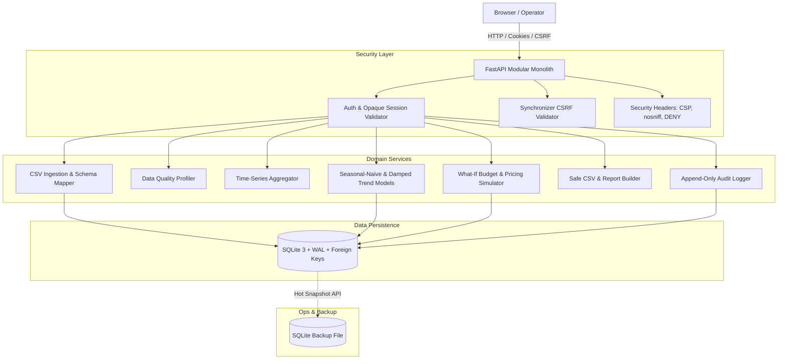

# System Architecture & Technical Design

## 1. Architectural Philosophy
The **Lake Toba Tourism Intelligence** platform is designed as a **Modular Monolith** adhering to local-first principles. It runs with zero external internet dependencies at runtime, operates efficiently within a bounded **2 GB RAM and 2 CPU core** resource envelope, and guarantees deterministic data reproducibility.

---

## 2. Component Design & Responsibilities

### 2.1 Web & Route Layer (`app/routes/`)
- Pure presentation and request parsing.
- Thin route controllers delegating all domain mathematics and persistence to service modules.
- Server-rendered HTML templates via Jinja2 with modern dark styling and accessible components.

### 2.2 Domain Service Layer (`app/services/`)
- **`ingestion_service.py`**: Reads UTF-8 / UTF-8 with BOM CSV streams, performs dry-run validation, and executes atomic transaction commits.
- **`quality_service.py`**: Evaluates dataset health, flagging null frequencies, duplicate keys, impossible hotel occupancy rates (&gt;100% or &lt;0%), and calendar continuity gaps.
- **`analytics_service.py`**: Executes daily, weekly (ISO calendar week), and monthly rollups with deterministic in-memory caching.
- **`forecast_service.py`**: Computes seasonal naive baselines (lag-7 for weekly cycles), damped Holt-Winters trend models, MAE, MASE, and 95% confidence intervals.
- **`scenario_service.py`**: Implements diminishing returns logarithmic curves for marketing budgets, price elasticity adjustments, gross contribution yield, and zero-safe ROI.
- **`export_service.py`**: Enforces OWASP formula-injection neutralization (`'`, `=`, `+`, `-`, `@`, `\t`, `\r`) on all CSV export streams.

### 2.3 Data Persistence (`app/database.py` & `app/models/entities.py`)
- SQLite with `PRAGMA foreign_keys = ON;` and `PRAGMA journal_mode = WAL;`.
- Connection busy timeout set to 15,000 ms to eliminate `database is locked` race conditions.
- Uses native `sqlite3.Connection.backup()` for non-blocking hot snapshots without database file corruption.

---

## 3. Data Flow Diagram

1. **Dataset Ingestion**:
   `Uploaded CSV` &rarr; `preview_csv_content()` &rarr; Validation Checks &rarr; `commit_csv_import()` &rarr; Atomic SQLite Write &rarr; `log_audit_event("DATASET_IMPORT")`.
2. **Forecast Execution**:
   `Chronological Query` &rarr; Split Train (0 to $N-H$) vs Val ($N-H$ to $N$) &rarr; Compute Baseline MAE &rarr; Fit Candidate Model &rarr; Compute MASE &rarr; Generate Future Points &rarr; Save to SQLite.
3. **Scenario Simulation**:
   Input Parameters (`Spend`, `PriceDelta`, `SeasonMult`) &rarr; Math Simulator (`simulate_scenario()`) &rarr; Return Live Figures &rarr; Persist `Scenario` &amp; `ScenarioAssumption`.
